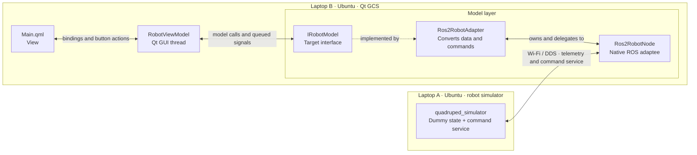

# Qt QML + ROS 2 quadruped PoC

Two Ubuntu 24.04 laptops on the same Wi-Fi network. Laptop A simulates a quadruped. Laptop B runs a Qt 6.12 QML ground control station with a C++ MVVM backend. Both laptops run ROS 2; the GCS uses native DDS discovery, so there is no WebSocket bridge or robot IP field in the application.

**Delivered source, not a prebuilt binary.** Simulator behavior tests passed on Ubuntu and Windows. Setup scripts passed syntax checks. The full ROS/Qt build, Qt tests, and two-laptop network test still need to run on machines with the dependencies installed. See [Verification](#verification).

## 1. Pick the ROS distribution

Use **the same ROS distribution on both laptops** and build the included interface package on both.

- **Kilted** is the newer ROS release targeting Ubuntu 24.04. The commands below default to it to match the request for a newer release.
- **Jazzy LTS** is a better choice for a project that will continue beyond this PoC: it targets Ubuntu 24.04 and is supported until May 2029. Set `POC_ROS_DISTRO=jazzy` wherever the guide uses `kilted`.
- As of 20 November 2026, Lyrical is the newest stable ROS distribution overall. Its standard Ubuntu target is 26.04. Do not install its Ubuntu binaries on 24.04. Kilted is scheduled to reach end of support in December 2026.

These choices follow the official [ROS release list](https://github.com/ros2/ros2_documentation/blob/kilted/source/Releases.rst) and [Ubuntu installation guidance](https://docs.ros.org/en/kilted/Installation/Ubuntu-Install-Debs.html). This source uses APIs shared by Jazzy and Kilted; neither full build has been executed in this workspace.

## 2. Architecture and MVVM boundaries



| Layer | File | Responsibility |
| --- | --- | --- |
| View | `src/quadruped_gcs/Main.qml` | Layout, display bindings, button actions |
| ViewModel | `src/quadruped_gcs/src/robot_view_model.*` | UI properties, freshness, pending commands, event log |
| Model interface | `src/quadruped_gcs/src/model/i_robot_model.hpp` | Transport-independent commands and signals consumed by the ViewModel |
| Model data | `src/quadruped_gcs/src/model/telemetry_snapshot.hpp` | Telemetry values independent of ROS message classes |
| Model adapter | `src/quadruped_gcs/src/model/ros2/ros2_robot_adapter.*` | Implements the interface, translates data/commands, owns the executor worker |
| Model ROS implementation | `src/quadruped_gcs/src/model/ros2/ros2_robot_node.*` | Native ROS subscription and service client; no Qt dependencies |
| Simulator | `src/quadruped_sim/src/main.cpp` | Telemetry publisher and command service |
| Shared contract | `src/qt_robot_interfaces/` | ROS `.msg` and `.srv` definitions |

### Adapter pattern in the Model layer

`IRobotModel` is the **target interface**, `Ros2RobotAdapter` is the **adapter**, and `Ros2RobotNode` is the **adaptee**. The adapter implements the interface and composes the native node. All three live under `src/quadruped_gcs/src/model/`.

`main.cpp` selects `Ros2RobotAdapter` and injects it as an `IRobotModel*` into `RobotViewModel`. The ViewModel does not include the concrete adapter, `rclcpp`, or generated ROS message/service types. `TelemetrySnapshot` is the Model data passed through that interface. A different backend can implement `IRobotModel` without changing the ViewModel or QML; the tests already do this with `FakeRobotModel`.

On incoming telemetry, the node invokes its native callback, the adapter converts the ROS message to `TelemetrySnapshot`, and the ViewModel receives the interface signal. On a command, the ViewModel calls the interface, the adapter converts the command and maps its operation ID to a ROS request ID, and the node invokes the ROS service. Replies return through the adapter as application-level signals. The adapter also handles timeout cleanup and stopping/joining the executor worker.

QML never imports ROS, opens a socket, or parses messages. Explicit `Qt::QueuedConnection` delivers Model signals to the GUI thread, following [Qt's thread and QObject guidance](https://doc.qt.io/qt-6/threads-qobject.html). The Qt event loop never waits for a service response. Qt documents the binding mechanism in [exposing C++ attributes to QML](https://doc.qt.io/qt-6/qtqml-cppintegration-exposecppattributes.html).

### ROS contract

| Interface | Type | Behavior |
| --- | --- | --- |
| `/quadruped/telemetry` | `qt_robot_interfaces/msg/Telemetry` | 5 Hz, reliable, volatile, keep last 1 |
| `/quadruped/command` | `qt_robot_interfaces/srv/RobotCommand` | Asynchronous request/response, standard ROS service QoS |

Telemetry includes battery percentage **0–100**, voltage, health, CPU temperature, posture, a varying dummy sensor, uptime, sequence, and a ROS timestamp. Battery drains slowly. Low battery means below 20%. These values are simulated, not a physical battery model. The custom battery percentage differs from `sensor_msgs/BatteryState.percentage`, which uses 0–1.

| Command | Observable result |
| --- | --- |
| `ping` | Returns a Pong response |
| `stand` | Next telemetry reports `STANDING` |
| `sit` | Next telemetry reports `SITTING` |
| `low_battery` | Battery becomes 15%; health becomes `LOW BATTERY` |
| `reset` | Battery returns to 100%; posture returns to `SITTING`; uptime continues |
| Any other string | Returns `accepted=false`; state stays unchanged |

The GCS marks telemetry stale after **2.5 seconds** without a valid received sample, keeps the last readings visibly dimmed, and disables commands. Freshness uses local monotonic receive time, so the laptops do not need synchronized clocks for this check. One command is allowed in flight. A **3-second** response timeout means **outcome unknown**; it does not cancel the robot operation. There is no automatic command replay. Reconnection and resubscription use DDS discovery; late replies cannot overwrite a newer command's result.

## 3. Install dependencies on both laptops

Copy this entire `qt_ros2_poc` folder to `~/qt_ros2_poc` on each laptop. Copy source only; do not share `build/`, `install/`, or `log/` between machines or ROS distributions. Use Bash terminals.

Install ROS 2 using the official [Kilted Ubuntu instructions](https://docs.ros.org/en/kilted/Installation/Ubuntu-Install-Debs.html) or [Jazzy Ubuntu instructions](https://docs.ros.org/en/jazzy/Installation/Ubuntu-Install-Debs.html). Complete the locale and ROS apt repository setup first. If ROS is already installed, keep the existing compatible installation.

After configuring the ROS apt repository, run on **both** laptops:

```bash
export POC_ROS_DISTRO=kilted  # Use jazzy on BOTH laptops for the LTS option.
sudo apt update
sudo apt install build-essential cmake python3-colcon-common-extensions \
  ros-dev-tools \
  "ros-$POC_ROS_DISTRO-ros-base" \
  "ros-$POC_ROS_DISTRO-rclcpp" \
  "ros-$POC_ROS_DISTRO-rclpy" \
  "ros-$POC_ROS_DISTRO-rmw-fastrtps-cpp" \
  "ros-$POC_ROS_DISTRO-rosidl-default-generators" \
  "ros-$POC_ROS_DISTRO-ament-cmake-test"
```

ROS Desktop is also sufficient; you do not need to replace it with ROS Base. Build tools require Ubuntu's normal updates repositories; consult the official installation page if apt reports conflicting dependencies.

### Qt on laptop B only

Install **Qt 6.12.x Desktop GCC 64-bit**, including Qt Declarative / Qt Quick / Qt Quick Controls, with the Qt installer. Qt Base also supplies Qt Test for the included tests. Qt Creator is optional. Ubuntu 24.04's default Qt packages do not provide Qt 6.12. See [Qt for Linux](https://doc.qt.io/qt-6/linux.html).

Install common development/runtime prerequisites:

```bash
sudo apt install libgl1-mesa-dev libxkbcommon-dev libxkbcommon-x11-0 \
  libxcb-cursor0 libxcb-icccm4 libxcb-image0 libxcb-keysyms1 \
  libxcb-render-util0 libxcb-xinerama0 libxcb-xkb1
```

Set the path to your actual installed kit; change the patch version/path as needed:

```bash
export QT_ROOT="$HOME/Qt/6.12.0/gcc_64"
test -f "$QT_ROOT/lib/cmake/Qt6/Qt6Config.cmake"
"$QT_ROOT/bin/qtpaths" --qt-version
```

The code requires Qt 6.12 or later. The instructions assume x86-64 laptops; use a matching Qt kit on ARM.

## 4. Build and run laptop A: robot

```bash
cd ~/qt_ros2_poc
export POC_ROS_DISTRO=kilted  # Or jazzy, consistently.
bash scripts/build.bash robot
source scripts/environment.bash
ros2 run quadruped_sim simulator
```

The terminal prints that telemetry is publishing at 5 Hz. Accepted and rejected commands are logged there. This build does not require Qt.

## 5. Build and run laptop B: GCS

```bash
cd ~/qt_ros2_poc
export POC_ROS_DISTRO=kilted  # Must match laptop A.
export QT_ROOT="$HOME/Qt/6.12.0/gcc_64"
bash scripts/build.bash gcs
source scripts/environment.bash
ros2 run quadruped_gcs gcs
```

Within a few seconds, the dashboard should show `ONLINE`, changing telemetry, and enabled buttons. Click **Stand**: the simulator terminal should log it, the GCS should show an accepted response, and posture should change to `STANDING`. The posture field always comes from telemetry, not an optimistic button update.

For later runs, use a new terminal, set `POC_ROS_DISTRO` if needed, and source `scripts/environment.bash` before `ros2 run`. You only need `QT_ROOT` when building; leave the Qt installation at the same location used for the build. To use Qt Creator, start it from that sourced terminal and open `src/quadruped_gcs/CMakeLists.txt` after the shared interfaces have been built. Select the Qt 6.12 kit.

## 6. Wi-Fi configuration

`scripts/environment.bash` sets these on both laptops:

```bash
export ROS_DOMAIN_ID=42
export RMW_IMPLEMENTATION=rmw_fastrtps_cpp
export ROS_AUTOMATIC_DISCOVERY_RANGE=SUBNET
unset ROS_LOCALHOST_ONLY
```

Both laptops must be on a network that allows peer-to-peer traffic. The same SSID alone is not enough if the router enables AP/client isolation, uses a guest network, or places clients on separate VLANs. Native ROS DDS discovery normally uses multicast. A ROS domain separates discovery groups; it does not authenticate clients.

Find each Wi-Fi IP with `ip -br address`. Confirm reachability with `ping <OTHER_LAPTOP_WIFI_IP>`. Ping is only a basic network check; success does not prove DDS multicast is working.

In separate sourced terminals, check multicast (then swap laptops):

```bash
# Laptop A
ros2 multicast receive
# Laptop B
ros2 multicast send
```

### If multicast is blocked but unicast works

Configure each peer explicitly **before starting the nodes**. Example addresses only:

```bash
# Laptop A, whose Wi-Fi IP is 192.168.1.10
export POC_DISCOVERY_RANGE=LOCALHOST
export ROS_STATIC_PEERS='192.168.1.11'
source scripts/environment.bash

# Laptop B, whose Wi-Fi IP is 192.168.1.11
export POC_DISCOVERY_RANGE=LOCALHOST
export ROS_STATIC_PEERS='192.168.1.10'
source scripts/environment.bash
```

Despite the name `LOCALHOST`, configured static peers can extend discovery to the specified remote hosts. Restart the simulator and GCS after changing discovery settings. This cannot bypass router client isolation or a firewall that blocks unicast DDS traffic. The settings follow ROS's [improved dynamic discovery guide](https://docs.ros.org/en/kilted/Tutorials/Advanced/Improved-Dynamic-Discovery.html).

If UFW is active, inspect `sudo ufw status`. On a trusted PoC network, an example scoped incoming rule on each laptop is `sudo ufw allow proto udp from <OTHER_LAPTOP_WIFI_IP>`; replace the placeholder with the actual peer address. Avoid disabling the entire firewall. VPNs and multiple active network interfaces may also affect discovery.

## 7. Verification

### Unit tests

On laptop A after its build:

```bash
source scripts/environment.bash
colcon test --packages-select quadruped_sim --event-handlers console_direct+
colcon test-result --verbose
```

On laptop B after its build:

```bash
source scripts/environment.bash
colcon test --packages-select quadruped_gcs --event-handlers console_direct+
colcon test-result --verbose
```

ViewModel tests cover cross-thread delivery, stale data, reconnection, unavailable services, acceptance/rejection, one pending request, timeout cleanup, late replies, and malformed telemetry. They use Qt Test and do not need a running robot or display server.

### ROS round trip across the two laptops

Keep the simulator running on A, and run on B:

```bash
source scripts/environment.bash
python3 scripts/check_ros.py
```

This exercises all five commands and rejection of an invalid command, checks telemetry feedback, and resets the simulated battery/posture on success.

### Actual QML app smoke test

With the simulator still running on A, run on B:

```bash
source scripts/environment.bash
QT_QPA_PLATFORM=offscreen QT_QUICK_BACKEND=software \
  ros2 run quadruped_gcs gcs --smoke-test
```

The real app loads its QML, waits for telemetry and the command service, sends Ping, and exits with code 0 only after an accepted reply. It exits nonzero on startup failure, command failure, or timeout. This checks the complete application path, including its ROS worker and ViewModel, without opening a window.

### Visual acceptance demo

1. Run the simulator and GCS on their respective laptops.
2. Verify battery, health, temperature, dummy sensor, uptime, and sequence update.
3. Click Stand, Sit, and Ping; verify both terminal and UI acknowledgements.
4. Click Low battery; verify the health warning. Click Reset to clear it.
5. Stop the simulator. Within about 2.5–2.6 seconds of the last sample, the UI should mark readings stale and disable commands.
6. Restart the simulator; telemetry and commands should recover after discovery.
7. Disconnect/reconnect Wi-Fi and repeat the recovery check. Do not expect a fixed recovery time from DDS/router discovery.

To first test on one laptop, use `bash scripts/build.bash all`, then run the simulator and GCS in separate sourced terminals. The application code and ROS names are identical for one- and two-laptop runs.

## 8. Troubleshooting

| Symptom | Check |
| --- | --- |
| `Package not found` | Source the selected ROS installation and this workspace's `install/setup.bash`; the helper does both. |
| `qt_robot_interfaces` missing | Build the whole dependency chain with `scripts/build.bash`; don't build only GCS without the interfaces. |
| Qt 6.12 not found | Verify `QT_ROOT` points to the kit, not Qt Creator or the parent `Qt` folder. |
| Qt platform plugin `xcb` cannot load | Install the listed XCB runtime libraries; use `QT_DEBUG_PLUGINS=1` for the missing-library name. |
| Window shows `WAITING FOR ROBOT` | Check matching distro/domain/RMW, multicast or static peers, Wi-Fi isolation, and firewall. |
| CLI works but UI is stale | Check QoS and that this version of the message package was built on both machines. Inspect terminal errors. |
| ROS CLI shows old/missing nodes | After changing domain/RMW, run `ros2 daemon stop` then `ros2 daemon start` in the newly sourced terminal. |
| Service is discovered but buttons stay disabled | Commands also require fresh telemetry and no pending command. |
| Command times out | The robot may have processed it; inspect telemetry and its terminal before retrying. |
| Qt or ROS distribution changed since a previous build | Use a fresh source copy/workspace to avoid mixing cached build dependencies. |

Useful commands on B in a sourced terminal:

```bash
ros2 node list
ros2 topic info /quadruped/telemetry --verbose
ros2 topic echo /quadruped/telemetry --once
ros2 topic hz /quadruped/telemetry
ros2 service list -t
ros2 service call /quadruped/command qt_robot_interfaces/srv/RobotCommand "{command: 'ping'}"
```

## Scope

This PoC proves typed telemetry display and acknowledged dummy commands over Wi-Fi. It contains no actuator control, authentication, video streaming, mapping, mission planning, or hard real-time control. For a future physical robot, short commands can remain services; operations that need progress/cancellation should use ROS actions, and continuous velocity control needs its own watchdog and control design.
