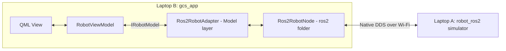

# Qt Creator GCS + standalone ROS 2 robot

This repository now contains **two independently copyable source folders**. Communication stays native ROS 2/DDS. The GCS keeps QML/MVVM and the adapter pattern in its Model layer.

| Folder | Copy to | How to run |
| --- | --- | --- |
| `gcs_app/` | GCS laptop | Open its standalone CMake project in Qt Creator using the supplied launcher |
| `robot_ros2/` | Robot laptop | Build with colcon and run the simulator |

Each folder includes its own README, scripts, and interface definitions. Neither folder references files in the other. Both machines still need ROS 2 Jazzy installed; the GCS also needs Qt 6.12. There is no network bridge.

## Laptop A: robot

Copy `robot_ros2/` to `~/robot_ros2`, then:

```bash
cd ~/robot_ros2
export POC_ROS_DISTRO=jazzy
bash scripts/build.bash
bash scripts/run.bash
```

Install the development dependencies listed in [robot_ros2/README.md](robot_ros2/README.md) before the first build. Leave the simulator terminal running.

## Laptop B: GCS in Qt Creator

Copy `gcs_app/` to `~/gcs_app`, then:

```bash
cd ~/gcs_app
export POC_ROS_DISTRO=jazzy
bash scripts/open_qtcreator.bash
```

The launcher builds only the GCS-local interface package, sources its environment, and opens `gcs_app/CMakeLists.txt` in Qt Creator. Choose your Qt 6.12 Desktop GCC kit, configure, build, and run the **gcs** target. The GCS application is built by ordinary CMake, not colcon.

If Qt Creator is not found, set `QT_CREATOR_BIN` to its executable before running the launcher. See [gcs_app/README.md](gcs_app/README.md) for exact setup, Qt Creator steps, an optional command-line build, and tests.

## Structure

```text
qt_ros2_poc/
  gcs_app/                         Independently copy this folder to Laptop B
    CMakeLists.txt                 Qt Creator project entry point
    qml/                           View
    src/
      main.cpp                     Application startup and dependency wiring
      viewmodel/                   UI properties and command handling
      model/
        i_robot_model.hpp          Model contract
        telemetry_snapshot.hpp     Model data
        adapters/                  Ros2RobotAdapter
    ros2/
      ros2_robot_node.*            Native ROS node used by the adapter
      interfaces_ws/src/
        qt_robot_interfaces/       GCS-local message/service source
    scripts/                       Prepare ROS, launch Qt Creator, build/run
    test/                          ViewModel tests
    README.md
  robot_ros2/                      Independently copy this folder to Laptop A
    src/
      qt_robot_interfaces/         Matching message/service source
      quadruped_sim/               Robot simulator
    scripts/                       Build/run, environment, ROS checks
    README.md
  tools/
    check_layout.py                Checks contracts, sources, and layer boundaries
    test_launchers.py              Tests copied-folder launchers with fake tools
    package.py                     Produces two standalone ZIPs and a full ZIP
```

The GCS's `ros2/` directory is separate from its View, ViewModel, and Model API. It must travel with `gcs_app/`: a native ROS GCS needs its own ROS node and generated message types. The robot workspace contains the robot-side publisher and command service.

## Adapter and data flow



The adapter translates between ROS messages and `TelemetrySnapshot`, delegates service calls to the ROS node, and owns the executor thread. The ViewModel knows only `IRobotModel`. QML binds to the ViewModel. The simulator publishes telemetry at 5 Hz and accepts Ping, Stand, Sit, Low battery, and Reset.

## Network and interfaces

Both launch paths default to ROS domain 42, `rmw_fastrtps_cpp`, and subnet discovery. Use the same Wi-Fi network with peer traffic and DDS discovery enabled. Each folder's README includes multicast diagnostics and a static-peer fallback.

The two `qt_robot_interfaces` source copies are intentional: each deliverable must build without its sibling. Keep them identical when changing messages/services, and rebuild both sides. Validate them from the repository root:

```bash
python3 tools/check_layout.py
```

## Packaging and migration

Create portable source ZIPs:

```bash
python3 tools/package.py
```

Outputs are `dist/gcs_app.zip`, `dist/robot_ros2.zip`, and `dist/qt_ros2_poc.zip`. Generated builds, installations, logs, Git metadata, and Qt Creator local settings are excluded. Transfer source and build on each laptop; existing build outputs are tied to their machine and path.

The old top-level `src/` colcon layout and `scripts/build.bash robot|gcs` commands have been replaced by the two folders above. The robot can still run through `ros2 run quadruped_sim simulator` after sourcing its environment. Run the GCS from Qt Creator or `gcs_app/scripts/run.bash`; it is no longer a colcon application package.

## Validation status

The simulator behavior test has passed on Ubuntu and Windows, and passed again on Ubuntu after restructuring. Interface equality, source/include references, MVVM boundaries, and Bash syntax checks passed. Five launcher tests passed for isolated copies under paths containing spaces, correct environment propagation, and error handling. These launcher tests use fake colcon/CMake/Qt Creator commands; they do not compile or launch the real GCS.

Run the launcher checks without installing the SDKs (Python 3 and Bash required):

```bash
python3 tools/test_launchers.py
```

Full compilation against Qt 6.12/ROS 2 Jazzy and the physical two-laptop Wi-Fi test remain to be run on machines with those SDKs installed.
